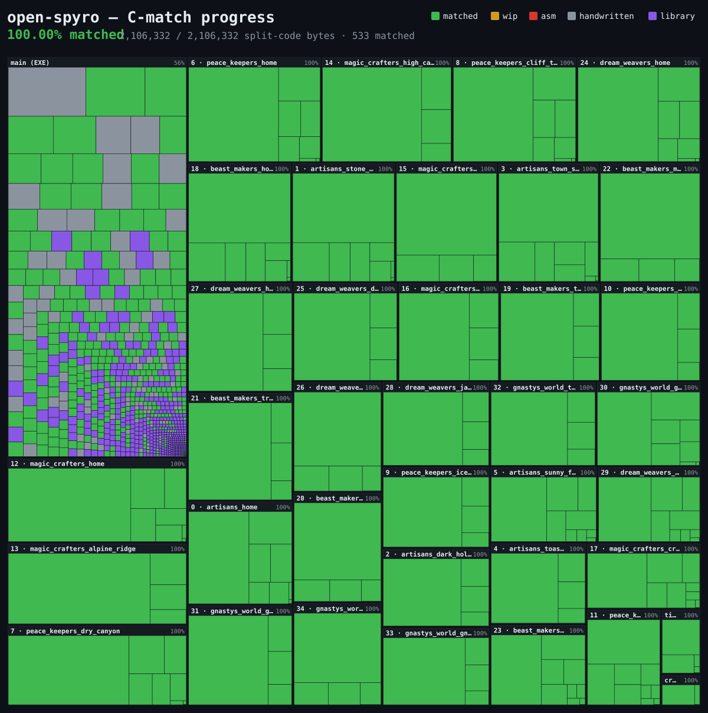

# open-spyro

<!-- progress-badge -->


<!-- /progress-badge -->


`open-spyro` is a **native port** of
[**Spyro the Dragon**](https://en.wikipedia.org/wiki/Spyro_the_Dragon) _(PS1,
NTSC, `SCUS_942.28`)_, built from a **byte-for-byte matching decompilation**.
The goal is a native executable that plays the game from your own disc image,
compiled from the same C that still rebuilds the original executable, all 37
overlays and `WAD.WAD` byte-identical.

> [!NOTE]
>
> **Status: the native build plays the game (experimental).** All game code is
> matched C. On macOS arm64, Linux arm64 and Linux x86_64, `make native` builds
> `build/native/spyro`, which boots the title, plays the opening cutscene and
> loads and plays all 35 levels, with sound, XA music and memory-card saves.
> Physics parity with the PS1 is still being checked. See
> [`docs/native.md`](docs/native.md).

_C-match progress (regenerated by `make progress`): see
[`PROGRESS.md`](PROGRESS.md)._

[](docs/progress_map.svg)

<sup>Each tile is one function, sized by its code bytes and grouped by layer
_(main EXE + 37 overlays)_</sup>

## One source, two builds

```
                    ┌─ gcc 2.7.2 (Docker) ──────────► SCUS_942.28 + overlays + WAD.WAD
src/ (matched C) ───┤                                 (byte-identical)
                    └─ wasi-sdk → wasm2c → host cc ─► build/native/spyro (macOS arm64,
                                                      Linux arm64/x86_64)
```

- **The native build** is the goal. The game C runs on
  [PsyZ](https://github.com/Xeeynamo/psyz) _(a PSY-Q SDK reimplementation, the
  `external/psyz` submodule)_ with an SDL3 backend. No CPU emulation: the
  hand-written asm is translated to C, and the game is compiled for wasm32 so it
  keeps 32-bit pointers and PS1 RAM at its real addresses, then wasm2c'd back to
  C for the host compiler _(details in [`docs/native.md`](docs/native.md))_.
- **The PS1 build** keeps the decompilation honest. Every change to shared C
  must still rebuild the original disc files byte for byte, so the native port
  can never drift from what the original code does.

## Core invariant

Every commit builds a **byte-identical** `SCUS_942.28`, all 37 overlays, and a
byte-identical `WAD.WAD`, and is always runnable in an emulator. Functions not
expressed in C (the PSY-Q SDK libraries and hand-written asm) link in as the
**original assembly** _(`INCLUDE_ASM`)_. **"Progress" = the fraction of game
code bytes expressed as verified-matching C** (now 100%). Native-port work does
not relax this: an edit that changes one PS1 output byte is reverted. Where the
PS1 text cannot serve both builds, the difference goes through `include/port.h`
or `#ifdef __psyz`, or into `src/native/game/`.

Target: `SCUS_942.28`, SHA-1 `84e3728ab94720d0873e2514adf4aade4935e0c5`, loads
at `0x80010000` _(file offset `0x800`)_. Main-EXE `.text` spans
`0x80012204`–`0x8006bb40`, 828 functions _(673 game code, 155 stock
PSY-Q/libc)_. 613 of these plus 982 globals were named in the old Ghidra project
_(reused here as a name/type dump only)_.

## Getting started

### Supplying the disc

You must supply your own original disc, copyrighted game data is never
committed. Drop your disc image into **`iso/`**: both the **`.cue`** and its
**`.bin`** are required _(the `.cue` is a text index that points at the `.bin`,
so the `.bin` must sit alongside it)_. A lone single-track `.bin` also works.
The native build reads the game's executable and data straight from this image.
For the PS1 build, `make extract` auto-detects the image there, dumps the files
into `disc/orig/` _(gitignored)_, and asserts the `SCUS_942.28` SHA-1.

The `.cue`/`.bin` hashes themselves vary by dumper and track layout, so they're
not a useful check. What `make extract` _(and `make verify`)_ pin instead are
the SHA-1s of the files _inside_ the disc, the two primary matched artifacts,
for reference:

| File          | SHA-1                                      |
| ------------- | ------------------------------------------ |
| `SCUS_942.28` | `84e3728ab94720d0873e2514adf4aade4935e0c5` |
| `WAD.WAD`     | `ab68001377ea93fb309a5c2a35e772c9d1f57e0b` |

_(The full baseline set, overlays, `.STR` streams, etc., lives in
`config/sha1sums.txt`.)_

### Native build _(macOS arm64, Linux arm64, Linux x86_64)_

Prerequisites: **[uv](https://docs.astral.sh/uv/)**, plus

- **macOS (Apple Silicon):** [Homebrew](https://brew.sh/) and the Xcode command
  line tools. The setup script installs SDL3 + cmake through Homebrew.
- **Linux:** a C/C++ compiler, cmake, curl and SDL3's development headers, plus
  a Vulkan driver _(Mesa's `mesa-vulkan-drivers` works)_. On Debian/Ubuntu the
  setup script prints the `apt install` line it needs; without a system SDL3 it
  builds the pinned release into `build/native-tools/sdl3`.

`tools/native_setup.sh` installs the rest _(pinned wasi-sdk + wasm2c, into
`build/native-tools/`)_.

```sh
tools/native_setup.sh   # pinned wasi-sdk + wasm2c (+ SDL3: Homebrew on macOS, system or pinned build on Linux)
make native             # -> build/native/spyro (fetches the external/psyz submodule)
make native-run         # plays the game from iso/*.cue (or NATIVE_DISC=path.cue)
```

Controls: arrows = D-pad, X / Z / S / D = Cross / Square / Triangle / Circle, Q
/ R / W / E = L1 / R1 / L2 / R2, Return = Start, Backspace = Select, or the
first SDL gamepad. Saves go to a `.mcd` card image compatible with DuckStation
_(`card1.mcd` in `~/Library/Application Support/open-spyro/spyro/` on macOS,
`~/.local/share/open-spyro/spyro/` on Linux)_. Pass options with
`NATIVE_ARGS="..."`: `--fast`, `--warp N:LEVEL`, scripted `--press` input and
`--shot` screenshots are covered in [`docs/native.md`](docs/native.md).
`build/native/spyro --stub` runs a test scene with no disc _(the CI smoke run;
set `SDL_VIDEODRIVER=offscreen` on a Linux machine with no display)_.

### PS1 matching build

Prerequisites:

- **Docker** - hosts the locked matching toolchain _(gcc 2.7.2 + binutils +
  maspsx)_. `make setup` builds the image; every compile/link/diff runs inside
  it.
- **[uv](https://docs.astral.sh/uv/)** - runs the host Python tooling. All the
  `open-spyro` subcommands _(`split`, `progress`, `diff`, `neutral`, …)_ are
  invoked through `uv run`; no manual venv is needed.
- **For `make iso`:** the host-native disc tools _(`mkpsxiso` + `dumpsxiso`,
  built by `make setup-iso`)_.

```sh
make setup      # build the matching toolchain (gcc 2.7.2 + binutils + maspsx + splat in Docker)
make setup-iso  # build the host-native disc tools (mkpsxiso + dumpsxiso) - needed for iso
make extract    # dump the original files from your disc image in iso/ (-> disc/orig/, gitignored)
make split      # disassemble into asm/ + config/
make build      # compile + link into a byte-identical SCUS_942.28 + overlays
make verify     # check rebuilt artifacts against the original SHA-1s
make iso        # repack into a .bin/.cue (-> build/SpyrotheDragon.{bin,cue})
make progress   # regenerate the C-match progress report
```

Run `make` with no target to print the target list.

#### Matching toolchain

- **Compiler:** gcc 2.7.2 _(the pinned decompals/old-gcc prebuilt `cc1`, in the
  Docker image at `/opt/gcc2.7.2/cc1`)_
- **Flags:**
  `-O2 -G8 -g3 -fverbose-asm -mips1 -mcpu=3000 -fgnu-linker -mno-abicalls -mgpopt -msoft-float`
  _(overlays override to `-G0`)_
- **Assembler:** `maspsx --aspsx-version 2.56 -G4 --expand-div` → GNU `as`/`ld`
- **Disasm/config:** splat / spimdisasm _(tools/open-spyro `split` group;
  `make split` runs them via `uv run`)_

#### Comparing a function against the original

When a C edit breaks `make verify`, the per-function byte-diff shows where:

```sh
uv run --project tools/open-spyro -- open-spyro diff <FunctionName>
# e.g. open-spyro diff ComputeInventoryProgressPercent
```

It rebuilds the containing artifact _(the main EXE, or the function's overlay)_,
slices the function's bytes at its VMA out of both the rebuilt file and
`disc/orig`, and prints an instruction-level side-by-side plus a match %. Exit
codes: `0` = byte-identical _(`MATCH`)_, `1` = differs, `2` = cannot run. Useful
flags: `--no-build` reuses the current build output as-is; `--full` prints every
instruction rather than just the diff hunks.

#### Building the ISO

`make iso` writes the repacked disc to the gitignored **`build/`** dir.

- `build/SpyrotheDragon.bin` + `build/SpyrotheDragon.cue` - the repacked disc
- `build/main/SCUS_942.28` - the rebuilt executable staged into it

## Layout

| Path          | Contents                                                                                                                                                                     |
| ------------- | ---------------------------------------------------------------------------------------------------------------------------------------------------------------------------- |
| `config/`     | splat yaml, `symbol_addrs.txt`, `*.ld` fragments                                                                                                                             |
| `src/`        | matched C: `main/<subsystem>/*.c` _(main EXE)_, `overlays/<segment>/*.c`                                                                                                     |
| `src/native/` | native-only code: `host/` _(SDL3 host, memory map, audio)_, `wasm/` _(SDK shim, libc, memcard)_, `game/` _(native replacements)_, `handasm/` _(translated hand-written asm)_ |
| `native/`     | CMake for the native build _(wasm module, host executable, ILP32 gate)_                                                                                                      |
| `external/`   | `psyz/` - PsyZ submodule _(PSY-Q SDK reimplementation for the native build)_                                                                                                 |
| `asm/`        | nonmatching `.s` _(`INCLUDE_ASM` targets)_ + extracted data `.s`                                                                                                             |
| `include/`    | `types.h`, `funcs.h`, `globals.h` _(seeded by the one-time Ghidra import)_, `port.h` _(PS1/native differences)_                                                              |
| `assets/`     | passthrough binaries _(WAD, STR, Crash demo, license)_                                                                                                                       |
| `tools/`      | `open-spyro` CLI _(uv package: progress, diff, wad, native, splat-gen helpers)_, `Dockerfile` _(matching toolchain)_, `native_setup.sh`                                      |
| `iso/`        | your source disc image goes here _(`.cue`/`.bin`, gitignored)_                                                                                                               |
| `disc/`       | `orig/` - files extracted from your disc _(gitignored)_                                                                                                                      |
| `build/`      | build output, incl. rebuilt `SCUS_942.28`, `SpyrotheDragon.{bin,cue}`, `native/spyro` _(gitignored)_                                                                         |

The main EXE's C is grouped by subsystem under `src/main/`, one file per role:

| `src/main/`  | Files                                                                                                 |
| ------------ | ----------------------------------------------------------------------------------------------------- |
| `boot/`      | `main.c` _(frame loop)_, `init.c` _(hardware/system init, new-game state)_                            |
| `load/`      | `level.c` _(level load + relocation, per-level tables)_, `cd_stream.c`, `anim_stream.c`               |
| `math/`      | `math.c` _(vector / fixed-point helpers; the rest is hand-written asm)_                               |
| `render/`    | `sprites.c` _(text, 2D overlays)_, `frame.c`, `portal_sky.c`, `ot.c`, `static_regs.c`                 |
| `gamestate/` | `draw.c` / `update.c` _(per-state handlers + dispatchers)_, `transitions.c`, `cheats.c`               |
| `camera/`    | `camera.c`                                                                                            |
| `actor/`     | `helpers.c` _(random, angles)_, `queries.c`, `movement.c`, `move_by_delta.c`, `effects.c`, `groups.c` |
| `spyro/`     | `anim.c`, `movement.c`, `collision.c`, `state.c`, `attack.c`, `triggers.c`                            |
| `pad/`       | `pad.c`                                                                                               |
| `hud/`       | `hud.c`                                                                                               |
| `sound/`     | `sound.c`, `play_sfx.c`, `voice_pan.c`                                                                |
| `particles/` | `particles.c`                                                                                         |
| `save/`      | `save.c`                                                                                              |

Overlays are still one function per file, under `src/overlays/<segment>/`.

Directories and files are grouping only. A file may define any number of
functions: `config/compile.sh` gives each one its own `.text.<fn>` /
`.rodata.<fn>` section, and every function still links into its own
fixed-address slot, so moving functions between files never changes the bytes as
long as each function still sees the same declarations. Function names must be
unique per segment (the build enforces it); objects mirror the source tree under
`build/<segment>/c/`. A function needs its own file (or an alias symbol, see
`config/symbol_addrs.txt` `_blk` entries) when it:

- declares a global or prototype with a different type than another function in
  the file sees (an array vs scalar view changes the addressing);
- declares a file-scope `register` variable (`ot.c`, `static_regs.c`);
- is `SDATA()`-declared small data that another function addresses absolutely.

## Contributing

Work is on the native port; every change must keep the PS1 build byte-identical:

1. **Edit the C.** Game code lives in `src/main/<subsystem>/` _(main EXE)_ and
   `src/overlays/<segment>/` _(overlays)_, shared by both builds. Native-only
   code goes in `src/native/`. Every PS1 build reruns `open-spyro gen-slots-ld`,
   which routes each function's compiled object into its fixed-VMA slot. **Never
   hand-edit `config/*.slots.ld`**.
2. **Check shared code stays neutral.** For a change to shared C or headers,
   `open-spyro neutral` confirms the PS1 preprocessor output is unchanged _(see
   [`docs/native.md`](docs/native.md))_.
3. **Build and run native.** `make native` must link _(signature mismatches are
   fatal on wasm)_; check the change in `make native-run`. For level-loader
   changes, `make native-gate SAVESTATE=...` compares the native load against
   PS1 RAM from a DuckStation savestate.
4. **Format & lint.** `make fmt` then `make lint` _(ruff + clang-format, same as
   CI)_.
5. **Prove the whole build still matches.** `make check` _(build + verify)_ must
   keep every artifact byte-identical. If it doesn't, `open-spyro diff <Name>`
   shows the offending function.

## Legal

This is an unofficial, fan-made decompilation project intended for preservation,
research, and educational purposes. It is **not affiliated with, authorized,
sponsored, or endorsed by Sony Interactive Entertainment, Insomniac Games, or
any of their subsidiaries or affiliates**.

_Spyro the Dragon_ and all associated names, characters, and assets are
trademarks and copyrights of their respective owners. No copyrighted game data
is distributed with this repository, building requires an original disc that you
must supply yourself. This project ships only original source code, disassembly,
and configuration derived through clean-room analysis.
