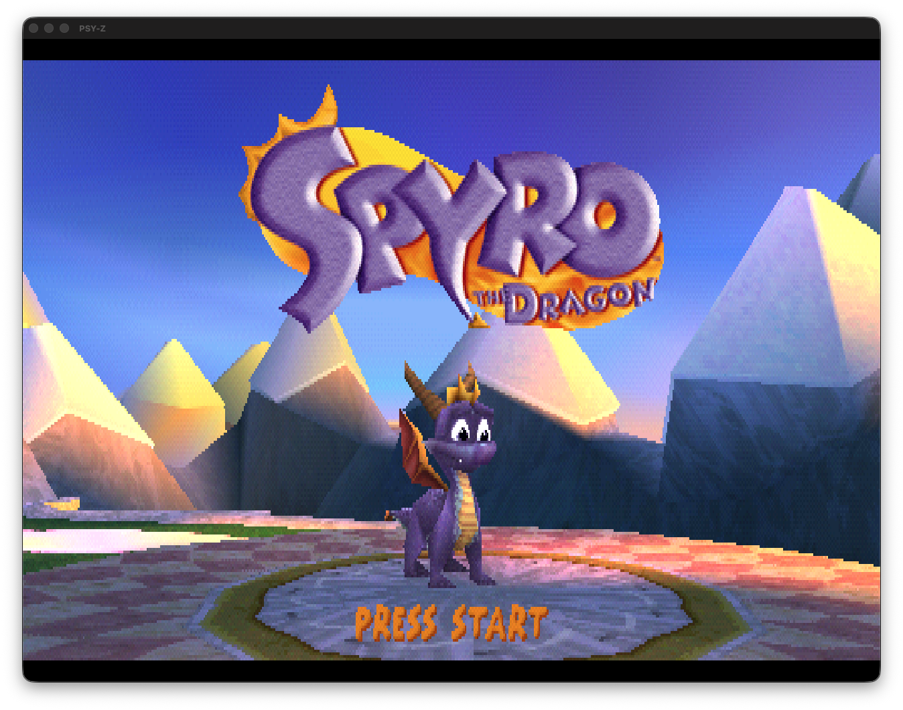

# open-spyro

<!-- progress-badge -->


<!-- /progress-badge -->



`open-spyro` is a **decompilation and source port** of
[**Spyro the Dragon**](https://en.wikipedia.org/wiki/Spyro_the_Dragon) _(PS1,
NTSC, `SCUS_942.28`)_. The decompilation is **byte-for-byte matching**: the C in
`src/` rebuilds the original executable, all 37 overlays and `WAD.WAD`
byte-identical. The source port compiles that same C into a native executable
that plays the game from your own disc image.

The current objective is to take that source to **as many platforms as
possible**. The ethos is the same as Doom's: Doom runs on anything because its
engine talks to the machine through a small, well-defined platform layer. We
want the same for Spyro, working toward a clean interface that a new platform
implements _(video, audio, input, storage, timing)_ without touching game code.

> [!NOTE]
>
> **Status: the native build plays the game (experimental).** All game code is
> matched C. The native build boots the title, plays the opening cutscene and
> loads and plays all 35 levels, with sound, XA music and memory-card saves.
> Physics parity with the PS1 is still being checked. See
> [`docs/native.md`](docs/native.md).

| Platform       | Status                  |
| -------------- | ----------------------- |
| macOS arm64    | ✅ Supported            |
| Linux x86_64   | ✅ Supported            |
| Linux arm64    | ✅ Supported            |
| Windows x86_64 | 🚧 Not yet, help wanted |
| Windows arm64  | 🚧 Not yet, help wanted |
| Web browser    | 🚧 Not yet, help wanted |

## Why

- **Preservation.** Original hardware ages and emulators come and go. With the
  game's source code in hand, very little stands between the original Spyro and
  whatever hardware comes next, for future generations to play.
- **It is worth preserving.** Spyro is a deeply aesthetic game: Stewart
  Copeland's soundtrack, expressive enemies, beautiful skyboxes and a liminal
  atmosphere all its own _(see [this video](https://youtu.be/Te7ozXtiT1k) and
  [this one](https://youtu.be/h_8ukKVIMhU))_. The goal is to keep that
  experience exactly as it was, not a remake of it.

## One source, two builds

```
                    ┌─ gcc 2.7.2 (Docker) ──────────► SCUS_942.28 + overlays + WAD.WAD
src/ (matched C) ───┤                                 (byte-identical)
                    └─ wasi-sdk → wasm2c → host cc ─► build/native/spyro
```

- **The native build** is the goal. The game C runs on
  [PsyZ](https://github.com/Xeeynamo/psyz) _(a PSY-Q SDK reimplementation, the
  `external/psyz` submodule)_ with an SDL3 backend. No CPU emulation: the
  hand-written asm is translated to C, and the game is compiled for wasm32 so it
  keeps 32-bit pointers and PS1 RAM at its real addresses, then wasm2c'd back to
  C for the host compiler _(details in [`docs/native.md`](docs/native.md))_.
- **The PS1 build** keeps the decompilation honest. Every commit must still
  rebuild the original disc files byte for byte, so the native port can never
  drift from what the original code does.

[](docs/progress_map.svg)

<sup>Each tile is one function, sized by its code bytes and grouped by layer
_(main EXE + 37 overlays)_. Full report in [`PROGRESS.md`](PROGRESS.md).</sup>

## How this differs from related projects

- **[TheMobyCollective/spyro-1](https://github.com/TheMobyCollective/spyro-1)**
  is a matching decompilation of the same executable. It rebuilds the original
  PS1 executable _(`PSX.EXE`, the same file as `SCUS_942.28`)_ and stops there:
  it does not produce a native port. open-spyro is an independent decompilation
  that keeps the same byte-matching guarantee, but treats it as the foundation
  for a source port: the matched C is also the code the native build compiles.
- **[tyscorp/openpete](https://github.com/tyscorp/openpete)** is a PC port of
  the Spyro trilogy built by **static recompilation**: it machine-translates the
  original MIPS code to C at build time, with a replacement PSY-Q library and a
  Vulkan renderer. open-spyro instead ports human-readable decompiled C _(only
  the small set of hand-written asm routines is translated)_, focuses on Spyro 1,
  and aims for a platform layer that reaches beyond PC.

## Getting started

### Supplying the disc

You must supply your own original disc; copyrighted game data is never
committed. Drop your disc image into **`iso/`**: both the **`.cue`** and its
**`.bin`** are required _(the `.cue` is a text index that points at the `.bin`,
so the `.bin` must sit alongside it)_. A lone single-track `.bin` also works.
The native build reads the game straight from this image; the PS1 build's
`make extract` dumps its files into `disc/orig/` _(gitignored)_.

The `.cue`/`.bin` hashes vary by dumper, so the build checks the files _inside_
the disc instead:

| File          | SHA-1                                      |
| ------------- | ------------------------------------------ |
| `SCUS_942.28` | `84e3728ab94720d0873e2514adf4aade4935e0c5` |
| `WAD.WAD`     | `ab68001377ea93fb309a5c2a35e772c9d1f57e0b` |

_(The full set, including overlays and `.STR` streams, is in
`config/sha1sums.txt`.)_

### Native build

Prerequisites: **[uv](https://docs.astral.sh/uv/)**, plus

- **macOS (Apple Silicon):** [Homebrew](https://brew.sh/) and the Xcode command
  line tools. The setup script installs cmake through Homebrew.
- **Linux:** a C/C++ compiler, cmake, curl and SDL3's build dependencies, plus a
  Vulkan driver _(Mesa's `mesa-vulkan-drivers` works)_. On Debian/Ubuntu the
  setup script prints the `apt install` line it needs.

```sh
tools/native_setup.sh              # pinned wasi-sdk + wasm2c + static SDL3
make native                        # -> build/native/spyro
cp spyro.example.toml spyro.toml   # then set `disc` in it to your .cue
make native-run                    # plays the game with spyro.toml
```

`spyro.toml` _(gitignored)_ holds the run settings: disc, memory cards, pad and
analog-stick tuning, camera and debug options, all documented in
[`spyro.example.toml`](spyro.example.toml). Flags in `NATIVE_ARGS="..."`
override it _(`--fast`, `--warp`, scripted `--press` input, `--shot`
screenshots; see [`docs/native.md`](docs/native.md))_.

| Keyboard               | PS1 pad                            |
| ---------------------- | ---------------------------------- |
| W A S D, arrows        | D-pad                              |
| K or Space / J / I / L | Cross / Square / Triangle / Circle |
| Q / E / U / O          | L1 / R1 / L2 / R2                  |
| Return / Backspace     | Start / Select                     |

The first SDL gamepad works too, analog sticks included. Saves go to a
DuckStation-compatible `.mcd` card image: `card1.mcd` in the repo root with the
example config, otherwise in `~/Library/Application Support/open-spyro/spyro/`
_(macOS)_ or `~/.local/share/open-spyro/spyro/` _(Linux)_.

### PS1 matching build

Prerequisites: **Docker** _(hosts the locked gcc 2.7.2 toolchain)_,
**[uv](https://docs.astral.sh/uv/)**, and for `make iso` the host disc tools
built by `make setup-iso`.

```sh
make setup      # build the matching toolchain image
make setup-iso  # build mkpsxiso + dumpsxiso (only needed for make iso)
make extract    # dump the original files from iso/ into disc/orig/
make split      # disassemble into asm/ + config/
make build      # compile + link SCUS_942.28 + overlays
make verify     # check rebuilt artifacts against the original SHA-1s
make iso        # repack into build/SpyrotheDragon.{bin,cue}
make progress   # regenerate the C-match progress report
```

Run `make` with no target to list every target.

## Contributing

Contributions are welcome, especially **Windows and web browser support**,
native parity fixes and readability work. See
[`CONTRIBUTING.md`](CONTRIBUTING.md) for the workflow, repository layout and
matching toolchain.

## Legal

This is an unofficial, fan-made decompilation project intended for preservation,
research, and educational purposes. It is **not affiliated with, authorized,
sponsored, or endorsed by Sony Interactive Entertainment, Insomniac Games, or
any of their subsidiaries or affiliates**.

_Spyro the Dragon_ and all associated names, characters, and assets are
trademarks and copyrights of their respective owners. No copyrighted game data
is distributed with this repository; building requires an original disc that you
must supply yourself. This project ships only original source code, disassembly,
and configuration derived through clean-room analysis.
